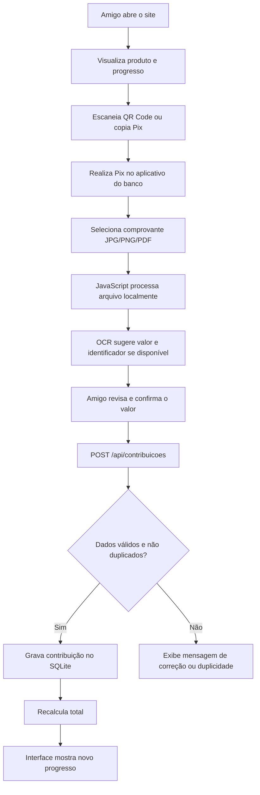

# Especificação — Vaquinha Pix (MVP)

> Documento de projeto do MVP. Para instalação e uso, veja o [README](../README.md).
> A implementação divergiu da spec em alguns pontos; as diferenças estão listadas no README.

## 1. Visão geral

Site simples para arrecadar contribuições via Pix para **um único produto**, durante **um único evento entre amigos**.

O pagamento é feito por **Pix estático** (QR Code e opção Copia e Cola). Depois de pagar, o participante envia o comprovante (imagem ou PDF). O navegador lê o arquivo localmente, extrai o valor e pede que a pessoa confirme os dados. Ao enviar a contribuição, o sistema registra o valor no SQLite e atualiza a barra de progresso para todos.

> **Premissa:** os participantes são pessoas conhecidas e confiáveis. Não haverá conferência bancária automática nem aprovação manual. Os valores exibidos são **contribuições declaradas por comprovante**, e não pagamentos bancariamente verificados.

## 2. Objetivo e escopo

### Incluído no MVP

- Página pública e responsiva, acessível pelo celular.
- Exibição de foto, nome, descrição e preço/meta do produto.
- Barra de progresso: valor arrecadado e percentual da meta.
- QR Code Pix estático e botão **Copiar Pix**.
- Upload de comprovante em **JPG, PNG ou PDF**.
- Extração do valor via OCR no próprio navegador.
- Campo editável para corrigir o valor se o OCR falhar.
- Confirmação pelo usuário antes de registrar a contribuição.
- Atualização do progresso após o envio, com consulta periódica à API.
- Armazenamento dos registros e configuração da vaquinha em SQLite.
- Prevenção básica de envios duplicados e limite de valor/tamanho do arquivo.

### Fora do escopo

- Cadastro/login de participantes.
- Múltiplas vaquinhas, campanhas ou produtos.
- Pix dinâmico ou integração com API bancária.
- Confirmação financeira real por webhook.
- Armazenamento de imagens ou PDFs dos comprovantes.
- Sistema completo de administração, estorno ou reembolso.

## 3. Tecnologias

| Camada | Tecnologia | Função |
| --- | --- | --- |
| Frontend | HTML, CSS e JavaScript | Interface e interação |
| OCR | Tesseract.js | Ler valores de imagens no navegador |
| PDF | PDF.js | Renderizar página do PDF para OCR e/ou extrair seu texto |
| Backend | Node.js + Fastify | API HTTP e arquivos estáticos |
| Banco | SQLite | Persistir vaquinha e contribuições |
| Driver SQLite | `better-sqlite3` | Acesso simples ao banco local |
| Hospedagem | VPS ou serviço Node com disco persistente | Executar Fastify e manter o `.db` |

**Observação:** SQLite é um arquivo armazenado no servidor. Para outros celulares acessarem e verem o mesmo total, é necessário um processo Node.js hospedado com armazenamento persistente. Hospedagens estáticas, por si só, não executam Fastify nem preservam o banco.

## 4. Fluxo principal



### Comportamento do Pix estático

- O QR Code aponta para **uma chave Pix do organizador**.
- Preferencialmente, gerar um código **sem valor fixo**, para permitir contribuições de qualquer quantia.
- O mesmo código é utilizado por todos os amigos.
- O site **não inicia nem acompanha** a transferência; ele apenas apresenta o QR Code e o código Copia e Cola.
- O pagamento acontece exclusivamente no aplicativo bancário.

## 5. Telas e experiência

### Página única (`/`)

1. **Produto:** imagem, nome e descrição curta.
2. **Meta:** valor total necessário, total declarado, percentual e barra de progresso.
3. **Pagamento:** QR Code estático, chave Pix e botão Copiar Pix.
4. **Comprovante:** selecionar arquivo e visualizar nome do arquivo.
5. **Revisão:** mostrar valor identificado pelo OCR; permitir alteração manual.
6. **Confirmação:** botão **Registrar minha contribuição**.
7. **Sucesso:** mensagem de agradecimento e barra de progresso atualizada.

Estados de interface: carregando, OCR em andamento, OCR sem resultado, valor inválido, duplicidade, erro de rede e sucesso.

**Privacidade:** processar os comprovantes no dispositivo do participante, sem enviá-los ao servidor. Os dados extraídos só são transmitidos após a confirmação.

## 6. Modelagem SQLite

Valores monetários são armazenados **em centavos (inteiros)**, evitando erros de ponto flutuante.

```sql
CREATE TABLE IF NOT EXISTS vaquinha (
    id INTEGER PRIMARY KEY CHECK (id = 1),
    titulo TEXT NOT NULL,
    descricao TEXT,
    imagem_url TEXT,
    meta_centavos INTEGER NOT NULL CHECK (meta_centavos > 0),
    chave_pix TEXT NOT NULL,
    pix_copia_cola TEXT NOT NULL,
    criado_em TEXT NOT NULL DEFAULT CURRENT_TIMESTAMP
);

CREATE TABLE IF NOT EXISTS contribuicao (
    id INTEGER PRIMARY KEY AUTOINCREMENT,
    nome TEXT,
    valor_centavos INTEGER NOT NULL CHECK (valor_centavos > 0),
    identificador_pix TEXT UNIQUE,
    comprovante_hash TEXT UNIQUE,
    criado_em TEXT NOT NULL DEFAULT CURRENT_TIMESTAMP
);
```

O identificador Pix (por exemplo, EndToEndId), **quando puder ser extraído com confiança**, ajuda a evitar que um comprovante seja contabilizado duas vezes. Um hash SHA-256 do arquivo também detecta **reenvio do arquivo idêntico**, mas não detecta arquivos diferentes da mesma transferência. A ausência de identificador não deve ser interpretada como comprovante inválido: o MVP pode permitir registro sem ele, informando a limitação.

### Cálculo do progresso

```sql
SELECT COALESCE(SUM(valor_centavos), 0) AS total_centavos
FROM contribuicao;
```

`percentual = (total_centavos / meta_centavos) * 100`.

A barra pode limitar visualmente a largura a 100%, enquanto o texto pode mostrar 110%, 125% etc. se a arrecadação ultrapassar a meta.

## 7. API REST (Fastify)

### `GET /api/vaquinha`

Retorna a configuração pública, o total arrecadado e o percentual calculado no servidor.

**Exemplo de resposta:**

```json
{
  "id": 1,
  "titulo": "Vaquinha do evento",
  "descricao": "Ajude a comprar o produto para nossa confraternização",
  "imagemUrl": "/images/produto.jpg",
  "metaCentavos": 150000,
  "totalCentavos": 75000,
  "percentual": 50,
  "chavePix": "chave-configurada-pelo-organizador",
  "pixCopiaCola": "codigo-pix-estatico-configurado"
}
```

### `POST /api/contribuicoes`

Registra uma contribuição declarada. **Não recebe imagem nem PDF.**

**Exemplo de requisição:**

```json
{
  "nome": "Amigo (opcional)",
  "valorCentavos": 5000,
  "identificadorPix": null,
  "comprovanteHash": "sha256-em-hex-do-arquivo"
}
```

**Resposta de sucesso:** `201 Created` com `id`, `valorCentavos` e novo `totalCentavos`.

**Erros previstos:**

- `400` — valor ou campos inválidos.
- `409` — identificador Pix ou hash do arquivo já registrado.
- `429` — excesso de requisições.
- `500` — erro interno.

Usar validação por JSON Schema no Fastify. Impor valor máximo por contribuição e limitar o tamanho do corpo JSON. A API nunca deve aceitar `totalCentavos` ou `percentual` enviados pelo cliente: ambos são calculados no servidor.

### `GET /api/health`

Retorna `200 OK` para checagem simples de disponibilidade.

## 8. Extração do comprovante no navegador

1. Validar extensão/tipo e tamanho (exemplo: até 5 MB).
2. Para imagem, carregar localmente e aplicar Tesseract.js.
3. Para PDF, tentar extrair texto com PDF.js; se o documento for escaneado, renderizar a primeira página e aplicar OCR. Permitir selecionar outra página se necessário.
4. Identificar padrões monetários brasileiros, como `R$ 50,00`.
5. **Não assumir que o primeiro valor encontrado é o Pix pago**: comprovantes podem conter saldo, tarifa ou outros valores. Preferir valores próximos a rótulos como "valor pago" ou "valor da transferência".
6. Apresentar o valor detectado para revisão e correção manual.
7. Calcular SHA-256 do arquivo com `crypto.subtle.digest` no navegador.
8. Enviar ao Fastify apenas nome opcional, valor em centavos e informações de deduplicação.
9. Limpar a referência ao arquivo após a operação.

**Importante:** não existe validação bancária neste fluxo. OCR, identificação de texto, hash e confirmação do usuário **não provam a autenticidade do pagamento**. O MVP usa confiança entre os amigos.

## 9. Atualização do progresso

**Escolha para o MVP:** polling simples.

- Ao abrir a página, solicitar `GET /api/vaquinha`.
- Após registrar contribuição, atualizar o progresso imediatamente com o total retornado pelo backend.
- Enquanto a página estiver aberta, consultar novamente a cada **5 segundos** (opcionalmente suspender em aba não visível).
- Evitar WebSockets, SSE e infraestrutura adicional nesta primeira versão.

## 10. Estrutura de diretórios sugerida

```text
vaquinha-pix/
├── package.json
├── .env.example
├── .gitignore
├── README.md
├── src/
│   ├── server.js           # Inicialização do Fastify
│   ├── routes/
│   │   ├── vaquinha.js     # GET /api/vaquinha
│   │   └── contribuicoes.js # POST /api/contribuicoes
│   └── db/
│       ├── connection.js   # Conexão SQLite
│       ├── schema.sql
│       └── seed.js         # Configuração inicial da única vaquinha
├── public/
│   ├── index.html
│   ├── styles.css
│   ├── app.js
│   ├── ocr.js
│   └── images/
│       ├── produto.jpg
│       └── qr-pix.png
└── data/
    └── vaquinha.sqlite    # Gerado em execução; não versionar
```

## 11. Configuração

Exemplo de `.env.example`:

```dotenv
PORT=3000
HOST=0.0.0.0
DATABASE_PATH=./data/vaquinha.sqlite
# Informações do produto/Pix cadastradas uma vez no seed ou na inicialização.
```

Instalação inicial prevista:

```bash
npm init -y
npm install fastify @fastify/static @fastify/rate-limit better-sqlite3 dotenv
```

As bibliotecas de OCR/PDF podem ser servidas como dependências frontend empacotadas localmente ou arquivos estáticos. Em produção, fixar versões, manter HTTPS e conferir compatibilidade das versões do Node.js e dos pacotes.

## 12. Regras básicas de segurança e operação

- Usar HTTPS em produção.
- Limitar taxa de `POST /api/contribuicoes` e tamanho das requisições.
- Validar e normalizar valores no servidor (inteiro positivo em centavos, com teto razoável).
- Não salvar comprovantes, CPF, dados bancários nem texto integral do OCR.
- Não disponibilizar o arquivo SQLite como arquivo público.
- Aplicar `UNIQUE` ao hash e ao identificador Pix, quando disponíveis; responder duplicidade de forma amigável.
- Não publicar rotas que permitam alterar meta, chave Pix ou total sem autenticação.
- Usar consultas parametrizadas e transações no SQLite.
- Fazer backup do `.sqlite` (por exemplo, com a API de backup do SQLite), especialmente antes e durante o evento.
- Guardar o banco em **volume persistente**: deployments que apagam o filesystem também apagam a arrecadação.
- Deixar claro no site que o total é declarado pelos participantes, sem confirmação bancária automática.

## 13. Critérios de aceite

- [ ] Site abre corretamente no celular.
- [ ] Produto e meta aparecem na página.
- [ ] QR Code e Pix Copia e Cola correspondem à chave do organizador.
- [ ] Participante pode selecionar imagem ou PDF sem enviá-lo ao backend.
- [ ] OCR sugere o valor, com edição manual permitida.
- [ ] Ao confirmar, o Fastify grava exatamente uma contribuição no SQLite.
- [ ] Reenviar o mesmo arquivo não soma novamente.
- [ ] Contribuições válidas aparecem no progresso após o envio.
- [ ] Outros celulares visualizam o novo valor em até 5 segundos, em condições normais.
- [ ] Após reiniciar a aplicação, os dados persistem.
- [ ] Se o OCR falhar, o usuário consegue informar manualmente o valor e prosseguir.

## 14. Etapas de implementação

1. Criar o projeto Node.js e configurar Fastify para servir a página estática.
2. Criar `schema.sql`, conexão SQLite e seed com os dados do único produto e do Pix.
3. Implementar `GET /api/vaquinha` e `POST /api/contribuicoes`.
4. Montar a página responsiva com meta, progresso e QR Code.
5. Implementar upload local de arquivo, PDF.js e Tesseract.js.
6. Implementar confirmação do valor, hash do arquivo, envio e prevenção de duplicidade.
7. Adicionar atualização a cada 5 segundos e estados de erro/sucesso.
8. Testar com dois celulares, comprovantes repetidos, PDFs escaneados e valores acima da meta.
9. Publicar em hospedagem Node com disco persistente e configurar backup.

## 15. Decisões de arquitetura

- **Sem integração bancária:** o total é declaratório; suficiente para o contexto de confiança entre amigos.
- **Sem guardar comprovantes:** menor custo, menos dados pessoais e implementação mais simples.
- **Com backend mínimo:** Fastify é necessário para compartilhar o mesmo banco entre dispositivos.
- **SQLite no lugar de banco gerenciado:** adequado para uma campanha pequena e poucas gravações simultâneas.
- **Polling no lugar de WebSocket:** simples e suficiente para progresso quase em tempo real.
- **Sem painel administrativo no MVP:** dados do produto e chave Pix são configurados antes do evento.
